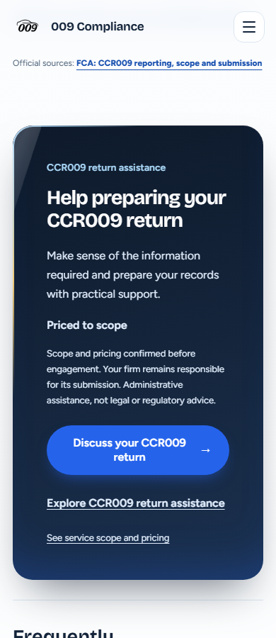
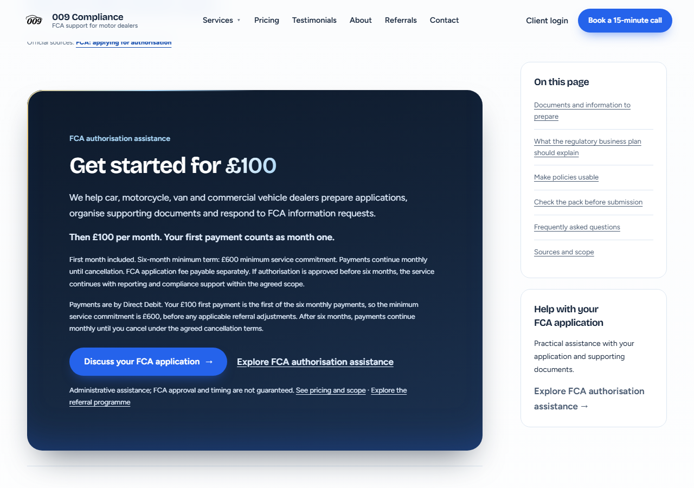
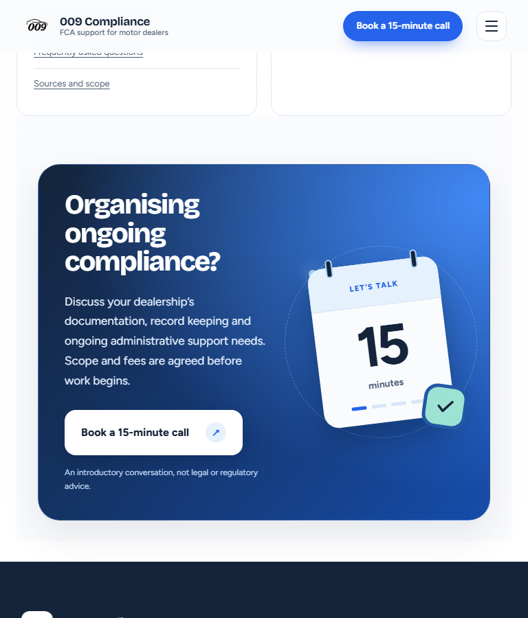

# Guide SEO implementation and verification — 12 November 2026

**Historical first-pass report. Superseded by [the research-backed follow-up](README-GUIDE-SEO-FOLLOWUP.md), which includes metadata restorations, contextual links, complete pricing fallback checks and measured performance. Counts and metadata below describe the earlier state. Open Graph article type was already present before this task; it was not a new SEO improvement.**

Implemented locally. No deployment, indexing request, real booking, personal-data entry or notification was performed.

## Scope and repository inspection

The public registry contains **33 pages**, of which **18 are informational guides/resources**. All 18 guide routes are listed below. Existing README-GUIDE-SEO-UPDATE.md and README-SEO-UPDATE.md describe the current rendering architecture; no applicable AGENTS.md was found in this checkout or its checked ancestor directories. The unrelated untracked file beginning “ite and integrate staff dashboard” was present before work and was not changed.

- Active content: config/guide-content.json. Active template for **every guide below**: views/seo_guide.ejs, selected by utils/seo.js templateSeo middleware. The middleware overrides the older route-selected guide views in server.js.
- Legacy templates (including ccr009_guide_page.ejs, *_exact.ejs and older individual guide views) remain untouched and are not the rendered source for these 18 paths. No new competing resource route was introduced.
- Shared layout and metadata: views/layout.ejs, utils/seo.js, config/seo-pages.json. Runtime /robots.txt and /sitemap.xml are generated by utils/seo.js; the static public copies are not the authoritative handlers.
- Guide promotions: partials/guide_offer.ejs, new partials/guide_reporting_offer.ejs, partials/guide_booking.ejs and the existing partials/motor_finance_art.ejs. Existing offer orbit/sheen, calendar and motor-finance animation code is reused without new runtime libraries or duplicated script initialization.
- FCA service: /fca-authorisation-motor-dealers → views/fca_authorisation_motor_dealers.ejs. Its existing £100 offer beside the service introduction is retained. Its existing closing calendar CTA now uses the shared partial with application-specific copy and its original in-page booking destination.
- Pricing: /pricing → views/pricing.ejs; approved authorisation terms remain in config/offer.js. /ccr009-return-assistance-motor-dealers and /motor-dealer-compliance remain the relevant service destinations.
- Booking: /contact → views/contact.ejs → partials/meeting_section.ejs and partials/meeting_form.ejs; public/js/booking-studio-uk-v41.js already accepts authorisation, ccr009 and ongoing topic parameters. Guide CTAs now pass these existing supported values.
- Other public pages were covered by the HTTP/metadata regression suite; their substantive content and service terms were not rewritten.

## What changed across all guides

All 18 descriptions were refined from their existing educational content. Ten titles were refined; eight already-distinct titles were retained after review. Each guide keeps its existing URL, main H1, meaningful section headings and logical hierarchy. The preparation workflow, final checklist, data requirements, scope, comparison and deadlines remain distinct search intents, without unsupported ranking or traffic claims.

Visible breadcrumbs now include the current guide, use an ordered list and aria-current, and match BreadcrumbList exactly. The shared navigation has a labelled “On this page” destination. Service anchors now name the relevant service; the existing section-level and related-guide links remain intact. The hub links to all 17 other guides.

Article and WebPage markup are generated from visible content; guides now use Open Graph article type. The existing social logo, intrinsic dimensions, alt text and loading choices are retained; Twitter image alt text was added. No author, accreditation, review, publication date or article hero image was invented. A source-check date is no longer misrepresented as dateModified; the visible 1 November 2026 source-check date remains unchanged. FAQPage markup was removed from guides while retaining every visible FAQ, consistent with [Google’s retirement of FAQ rich results](https://developers.google.com/search/updates#june-2026).

All content and metadata remain in server-rendered HTML. Existing indexable robots directives, self-canonicals, sitemap entries and direct canonical-variant redirects were verified and retained. No URL migration or artificial sitemap lastmod was needed.

The repeated hero booking button was replaced with guide navigation. FCA offers now follow the complete main explanation, before FAQs; CCR009 guides have a relevant reporting offer in that position. Ongoing guides use the existing service link and closing booking CTA. Existing separately qualified motor-finance panels on five guides were preserved rather than rewriting their content. No seasonal wording, countdown or old price was added to any guide.

## Page-by-page changes

“Shared improvements” means matching visible/structured breadcrumbs, Article/social metadata corrections, preserved headings and dates, descriptive service navigation, and a topic-specific animated closing booking CTA.

| Guide and established route | Distinct intent | SEO change | Offer / booking placement |
| --- | --- | --- | --- |
| [Do Motor Dealers Need FCA Authorisation?](https://009compliance.com/do-motor-dealers-need-fca-authorisation) <code>/do-motor-dealers-need-fca-authorisation</code> | Determine whether authorisation or a principal arrangement is needed | Title reviewed and retained; description rewritten for this intent; shared improvements below. | Qualified £100 animated offer after “Prepare before you apply”, before FAQs; closing application booking CTA. Existing separate motor-finance panel retained. |
| [FCA Licence for Car Dealers: Authorisation, FRNs and Permissions](https://009compliance.com/fca-licence-car-dealers) <code>/fca-licence-car-dealers</code> | Understand licence terminology and check FRNs/status | Title refined; description rewritten for this intent; shared improvements below. | Qualified £100 animated offer after “If you are applying for the first time”, before FAQs; closing application booking CTA. |
| [Limited Permission FCA Authorisation for Motor Dealers](https://009compliance.com/limited-permission-fca-authorisation-motor-dealers) <code>/limited-permission-fca-authorisation-motor-dealers</code> | Compare limited/full permission by business model | Title refined; description rewritten for this intent; shared improvements below. | Qualified £100 animated offer after “A useful preparation exercise”, before FAQs; closing application booking CTA. Existing separate motor-finance panel retained. |
| [Credit Broking Permission for Motor Dealers](https://009compliance.com/credit-broking-permission-motor-dealers) <code>/credit-broking-permission-motor-dealers</code> | Understand the dealer’s credit-broking role and permission boundaries | Title reviewed and retained; description rewritten for this intent; shared improvements below. | Qualified £100 animated offer after “Illustrative customer journey”, before FAQs; closing application booking CTA. Existing separate motor-finance panel retained. |
| [FCA Application Documents for Motor Dealers: Preparation Checklist](https://009compliance.com/fca-application-documents-motor-dealers) <code>/fca-application-documents-motor-dealers</code> | Prepare application documents and supporting evidence | Title refined; description rewritten for this intent; shared improvements below. | Qualified £100 animated offer after “Check the pack before submission”, before FAQs; closing application booking CTA. |
| [Why FCA Applications Get Delayed: A Motor Dealer Guide](https://009compliance.com/why-fca-applications-get-delayed) <code>/why-fca-applications-get-delayed</code> | Understand assessment delays and preparation checks | Title refined; description rewritten for this intent; shared improvements below. | Qualified £100 animated offer after “What assistance can and cannot do”, before FAQs; closing application booking CTA. |
| [After FCA Approval: A Motor Dealer’s Next Steps](https://009compliance.com/after-fca-approval-motor-dealers) <code>/after-fca-approval-motor-dealers</code> | Organise responsibilities after approval | Title reviewed and retained; description rewritten for this intent; shared improvements below. | Unrelated FCA application offer removed; closing ongoing-support booking CTA. Existing separate motor-finance panel retained. |
| [What Is CCR009? FCA Reporting for Motor Dealers](https://009compliance.com/what-is-ccr009) <code>/what-is-ccr009</code> | Understand the purpose and scope of CCR009 | Title refined; description rewritten for this intent; shared improvements below. | Animated CCR009 “Priced to scope” offer after “Reporting is different from internal record collection”, before FAQs; closing reporting booking CTA. |
| [Who Needs to Submit CCR009? A Motor Dealer Guide](https://009compliance.com/who-needs-to-submit-ccr009) <code>/who-needs-to-submit-ccr009</code> | Determine which firms and arrangements need CCR009 | Title reviewed and retained; description rewritten for this intent; shared improvements below. | Animated CCR009 “Priced to scope” offer after “Keep a short scope record”, before FAQs; closing reporting booking CTA. |
| [What Information Is Needed for CCR009?](https://009compliance.com/what-information-is-needed-for-ccr009) <code>/what-information-is-needed-for-ccr009</code> | Map return questions to records and financial measures | Title reviewed and retained; description rewritten for this intent; shared improvements below. | Animated CCR009 “Priced to scope” offer after “Separate the return from wider compliance records”, before FAQs; closing reporting booking CTA. |
| [CCR009 Reporting Checklist for Motor Dealers](https://009compliance.com/ccr009-reporting-checklist-motor-dealers) <code>/ccr009-reporting-checklist-motor-dealers</code> | Check readiness and confirm final submission | Title reviewed and retained; description rewritten for this intent; shared improvements below. | Animated CCR009 “Priced to scope” offer after “A suggested readiness check”, before FAQs; closing reporting booking CTA. |
| [CCR009 vs CCR007: What Motor Dealers Need to Know](https://009compliance.com/ccr009-vs-ccr007) <code>/ccr009-vs-ccr007</code> | Compare two distinct reporting obligations | Title refined; description rewritten for this intent; shared improvements below. | Animated CCR009 “Priced to scope” offer after “A practical way to manage both”, before FAQs; closing reporting booking CTA. |
| [CCR009 Reporting Mistakes Motor Dealers Should Check For](https://009compliance.com/common-ccr009-reporting-mistakes) <code>/common-ccr009-reporting-mistakes</code> | Identify and prevent potential reporting errors | Title reviewed and retained; description rewritten for this intent; shared improvements below. | Animated CCR009 “Priced to scope” offer after “Keep the review proportionate”, before FAQs; closing reporting booking CTA. |
| [How to Prepare for a CCR009 Return](https://009compliance.com/how-to-prepare-for-ccr009-return) <code>/how-to-prepare-for-ccr009-return</code> | Plan the preparation workflow and responsibilities | Title reviewed and retained; description rewritten for this intent; shared improvements below. | Animated CCR009 “Priced to scope” offer after “Maintain records between returns”, before FAQs; closing reporting booking CTA. |
| [When Is CCR009 Due? Reporting Periods and Deadlines](https://009compliance.com/when-is-ccr009-due) <code>/when-is-ccr009-due</code> | Find reporting periods, frequency and the actual deadline | Title refined; description rewritten for this intent; shared improvements below. | Animated CCR009 “Priced to scope” offer after “CCR007 has a separate schedule”, before FAQs; closing reporting booking CTA. |
| [Consumer Duty for Motor Dealers: Outcomes and Practical Checks](https://009compliance.com/consumer-duty-motor-dealers) <code>/consumer-duty-motor-dealers</code> | Understand customer outcomes and proportionate monitoring | Title refined; description rewritten for this intent; shared improvements below. | Unrelated FCA application offer removed; closing ongoing-support booking CTA. |
| [Website Compliance for Motor Dealers: A Practical Checklist](https://009compliance.com/website-compliance-motor-dealers) <code>/website-compliance-motor-dealers</code> | Review customer-facing website disclosures and promotions | Title refined; description rewritten for this intent; shared improvements below. | Unrelated FCA application offer removed; closing ongoing-support booking CTA. |
| [FCA Compliance for Motor Dealers: Guides and Next Steps](https://009compliance.com/fca-compliance-motor-dealers-guide) <code>/fca-compliance-motor-dealers-guide</code> | Navigate the guide library by stage and responsibility | Title refined; description rewritten for this intent; shared improvements below. | Unrelated FCA application offer removed; closing ongoing-support booking CTA. Existing separate motor-finance panel retained. |
| [FCA authorisation service](https://009compliance.com/fca-authorisation-motor-dealers) | Service enquiry and payment terms | Existing service title, description and substantive content retained and checked | Existing £100 animated offer retained beside service explanation; closing calendar CTA uses shared application copy and #book-meeting. |

## Final titles and descriptions

These values are synchronized in the guide content and SEO registries and verified in HTTP HTML and the browser DOM.

| Route | Title | Description |
| --- | --- | --- |
| <code>/do-motor-dealers-need-fca-authorisation</code> | Do Motor Dealers Need FCA Authorisation? \| 009 Compliance | Check when motor-dealer finance introductions need FCA authorisation, how AR and IAR arrangements differ, and what to assess before applying. |
| <code>/fca-licence-car-dealers</code> | FCA Licence for Car Dealers: FRNs & Permissions \| 009 Compliance | Understand FCA licence terminology, authorisation, FRNs and permissions. Learn how to check a dealership’s status on the Financial Services Register. |
| <code>/limited-permission-fca-authorisation-motor-dealers</code> | Limited vs Full FCA Permission: Motor Dealers \| 009 Compliance | Compare limited and full FCA permission scenarios for motor dealers, including owned stock, vehicle sourcing and part-exchanges with outstanding finance. |
| <code>/credit-broking-permission-motor-dealers</code> | Credit Broking Permission for Motor Dealers \| 009 Compliance | Understand credit broking roles in motor finance, introductions to lenders and brokers, permission limits and the steps in a dealership customer journey. |
| <code>/fca-application-documents-motor-dealers</code> | FCA Application Documents: Motor Dealer Checklist \| 009 Compliance | Prepare motor-dealer FCA application documents: business plans, ownership and financial information, customer journeys, policies and pre-submission checks. |
| <code>/why-fca-applications-get-delayed</code> | FCA Application Delays: Motor Dealer Checks \| 009 Compliance | Understand FCA assessment timescales, preparation issues and follow-up requests. See practical checks for motor dealers and the limits of application assistance. |
| <code>/after-fca-approval-motor-dealers</code> | After FCA Approval: Motor Dealer Checklist \| 009 Compliance | Use a practical post-authorisation checklist for permission conditions, staff, website disclosures, systems access, CCR009 reporting and business changes. |
| <code>/what-is-ccr009</code> | What Is CCR009? FCA Motor Dealer Reporting \| 009 Compliance | Learn what the FCA’s CCR009 return covers, which reporting it replaced and how motor dealers can prepare. Distinguish FCA filing from internal record collection. |
| <code>/who-needs-to-submit-ccr009</code> | Who Needs to Submit CCR009? \| 009 Compliance | Check CCR009 reporting scope for motor dealers, inactive firms, principals and appointed representatives using permissions and the firm’s actual schedule. |
| <code>/what-information-is-needed-for-ccr009</code> | What Information Is Needed for CCR009? \| 009 Compliance | Map CCR009 questions to dealership source records. Check field definitions, reporting periods and financial measures, with a fictional reconciliation example. |
| <code>/ccr009-reporting-checklist-motor-dealers</code> | CCR009 Reporting Checklist for Motor Dealers \| 009 Compliance | Check CCR009 readiness before submission: access, period, evidence, reconciliation, unresolved questions and confirmation that the return has been submitted. |
| <code>/ccr009-vs-ccr007</code> | CCR009 vs CCR007: Scope, Frequency & Deadlines \| 009 Compliance | Compare CCR009 and CCR007 purposes, scope, reporting periods and deadlines. Understand the FCA’s reduced-information instructions and manage each return separately. |
| <code>/common-ccr009-reporting-mistakes</code> | CCR009 Reporting Mistakes to Check For \| 009 Compliance | Check for wrong CCR009 periods, mixed financial measures, duplicate records and unsupported zero answers. Review examples, prevention steps and submission errors. |
| <code>/how-to-prepare-for-ccr009-return</code> | How to Prepare for a CCR009 Return \| 009 Compliance | Plan CCR009 preparation in stages: responsibilities, system access, source records, reconciliation, review and submission. Build an internal workflow for your firm. |
| <code>/when-is-ccr009-due</code> | When Is CCR009 Due? Periods & Deadlines \| 009 Compliance | Understand CCR009’s calendar-based reporting periods, the larger-firm exception and 40-business-day window. Find your firm’s exact due date in its FCA schedule. |
| <code>/consumer-duty-motor-dealers</code> | Consumer Duty: Motor Dealer Outcomes & Checks \| 009 Compliance | Explore the four Consumer Duty outcomes for motor dealers, responsibilities by role, practical monitoring evidence, vulnerable-customer support and follow-up actions. |
| <code>/website-compliance-motor-dealers</code> | Motor Dealer Website Compliance Checklist \| 009 Compliance | Review dealership website status wording, finance promotions, commission disclosures and customer support. Use a practical checklist for the whole customer journey. |
| <code>/fca-compliance-motor-dealers-guide</code> | FCA Compliance for Motor Dealers: Guide Hub \| 009 Compliance | Find the right motor-dealer guide for authorisation, permissions, post-approval tasks, Consumer Duty, website checks and CCR009 reporting preparation and deadlines. |

## Approved commercial terms

Verified against both the repository and the [live pricing page](https://009compliance.com/pricing): £100 first payment is month one, then £100 monthly by Direct Debit, six-month minimum and £600 minimum service commitment before applicable referral adjustments. Payments continue monthly until cancellation under the agreed terms; the FCA application fee is separate. Approval and decision timing are not guaranteed. Existing config/offer.js and config/campaign.js were not edited. The live site's existing seasonal decoration was not propagated into guides.

Standalone CCR009 assistance is **priced to scope**, with scope and pricing agreed before engagement and the firm retaining submission responsibility. Ongoing-support fees depend on the agreed scope. Neither is advertised as the FCA application offer. VAT treatment and a specific cancellation notice period remain unconfirmed in the existing configuration and were not invented.

## Content preservation

**18/18 source comparisons and 18/18 rendered educational comparisons pass. No substantive-content exceptions.** Source comparison excludes only seoTitle and description. All original answers, headings, paragraphs, examples, tables, lists, FAQs, official-source links, related-guide lists, regulatory qualifications and source-check dates are equal. The original source JSON, compressed original rendered HTML and extracted browser text are retained under docs/guide-seo-2026-11, with hashes in preservation-results.json.

Intentional changes outside educational content: metadata, breadcrumb/navigation presentation, the generic booking copy, offer location, removal/replacement of irrelevant FCA promotions, and fuller authorisation payment qualifications. Existing service paragraphs and contractual configuration were preserved; only the service’s closing promotional invitation was refactored.

## Actual test results

- Production asset build passed: **58 content-addressed assets**. Only the guide CSS fingerprint changed; no animation JavaScript or runtime dependency was added.
- **npm.cmd run test:seo: 14/14 passed. npm.cmd test: 65/65 passed.** Includes all 33 public-page HTTP statuses, unique metadata, canonicals, JSON-LD, assets, robots/sitemap inclusion, one-hop variant redirects, private-page noindex, CSRF and isolated backend/booking tests.
- Chromium: **76/76 route/width checks passed** (18 guides + FCA service × 320, 390, 768, 1280 pixels; 900px height). No horizontal overflow, broken images, duplicate IDs/scripts, heading-level jumps or route console errors. Guide load/scroll CLS was 0 in these runs; maximum service-page CLS was 0.000434. These are local observed values, not field Core Web Vitals or a guarantee across devices.
- **191 internal destination/fragment checks passed**, including breadcrumbs, related guides, services, pricing and booking anchors.
- **19/19 reduced-motion and 19/19 JavaScript-disabled route checks passed.** Calendar art reserves its dimensions, remains static with reduced motion and leaves usable text/links without JavaScript. Existing offer animations were verified active on relevant guides; their reduced-motion rules disable both animation and transitions.
- Keyboard: native FAQ expansion and closing CTA activation passed for each guide family and the FCA service. Focus indicators are visible; booking destinations preselect the correct topic. Representative screenshots were visually inspected for spacing, wrapping and overlap.
- Isolated preview uses a temporary database, does not load .env, and disables mail and external integrations. Its unconfigured availability state was confirmed honestly; a read-only availability fixture then exercised date → time → contact details without submission.
- **Live booking verification also passed**, separately and read-only: /pricing and /contact returned 200; real availability returned 200; a future available time opened the contact-details step with CCR009 selected. No personal details were entered, no booking was submitted, and no notifications were sent. The script blocks non-GET/HEAD requests. See live-booking-results.json.
- git diff --check and JavaScript syntax checks passed. Existing unrelated untracked work remains untouched.

Evidence: [browser results](docs/guide-seo-2026-11/browser-results.json), [preservation results](docs/guide-seo-2026-11/preservation-results.json), [live booking results](docs/guide-seo-2026-11/live-booking-results.json).

## Limitations and separate recommendations not applied

- No authorized Search Console connection was available. Prioritization used repository content, rendered pages and distinct intents; no traffic, CTR, rankings or search volumes were inferred. After a separately authorized release, use real Search Console query/page data to assess overlap and snippets.
- No public deployment, indexing request or Google rich-result eligibility claim. Structured-data checks were local JSON/DOM checks, not a live Google URL Inspection or Rich Results Test submission.
- Browser coverage used desktop Chromium with responsive widths, reduced motion and JavaScript disabled. Other engines, physical-device assistive technology and field performance were not measured. Internal links were checked; linked FCA sources were preserved, not exhaustively audited for regulatory accuracy in this SEO-only task.
- Have the business confirm VAT treatment and any cancellation notice period before adding them. These would be commercial-content changes, so no wording was guessed.
- Keep future regulatory source reviews separate from SEO housekeeping. Any rule, deadline, permission-scope or commission-disclosure change needs an explicit substantive review. This work did not silently update regulatory advice or stamp the guides with today’s date.
- Add a named author/reviewer or article imagery only if genuine attribution and suitable assets are supplied. Do not assign the logo as a fictional article photograph or invent credentials.
- The existing Browserslist compatibility dataset emitted an outdated-data notice during the successful build. Dependency maintenance was not mixed into this change.

## Guidance used

The implementation follows [Google’s title-link guidance](https://developers.google.com/search/docs/appearance/title-link) and [snippet guidance](https://developers.google.com/search/docs/appearance/snippet) for descriptive, page-specific metadata; [BreadcrumbList guidance](https://developers.google.com/search/docs/appearance/structured-data/breadcrumb) for hierarchy matching the visible navigation; and [Article guidance](https://developers.google.com/search/docs/appearance/structured-data/article) for factual properties. [Canonical guidance](https://developers.google.com/search/docs/crawling-indexing/consolidate-duplicate-urls) supports retaining one consistent established URL. Google may choose different titles/snippets; no ranking outcome is promised.

## Reproduce locally

Use the existing dependencies, then run npm.cmd run build and npm.cmd test. Browser QA additionally uses an isolated ignored tool directory: npm.cmd install --prefix .qa --no-save --package-lock=false --ignore-scripts playwright-core@1.58.2 (with a compatible locally installed Chromium). No production package/lockfile changes are required.

Start node scripts/guide-seo-preview.cjs; in another terminal run node scripts/guide-seo-browser.cjs. The --baseline mode replays the compressed pre-change rendered HTML and regenerates the educational baseline; it is not needed for a normal regression run. Stop the preview when finished. The optional node scripts/guide-seo-live-check.cjs makes read-only live requests and stops before submission; it requires network access. No script deploys or requests indexing.
